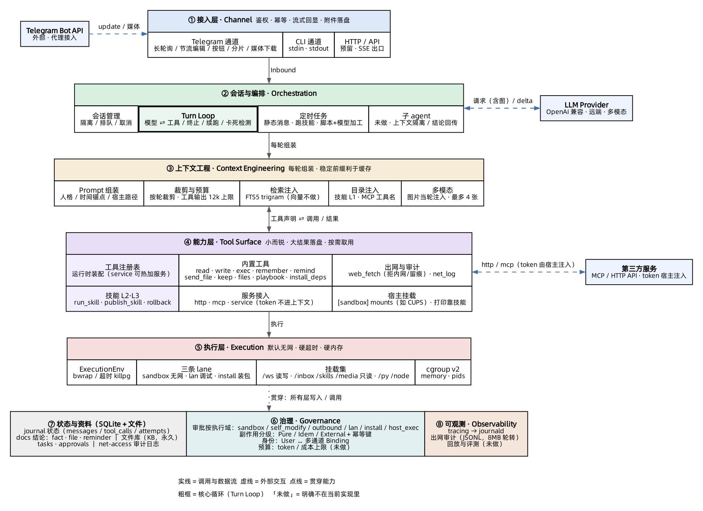

# 家庭智能管家 Harness · 概要设计

> 部署约束：**Rust 单二进制 · RISC-V SBC（riscv64 / 8GB / 无第二台机器）· 无中间件 · Telegram 为主入口，CLI 并级**。
> 层编号以 **L1–L10** 为唯一体系（映射见 `DATA-MODEL.md §1`）；契约见 `INTERFACES.md`；取舍见 `DECISIONS.md`；运维见 `OPS.md`。

---

## 1. 定位

一个常驻家庭的**个人助理 harness**：家人可共用（只读），主人可扩展。核心差异化是**自我提升闭环**——在沙盒里调试脚本 → 主人确认 → 泛化为技能 → 热加载生效。

它不是聊天机器人，是**能安全执行动作**的 agent 运行时：能跑命令、能打印、能定时提醒、能看图，且**每次动作可审计、可恢复、可回滚**。

---

## 2. 十层模型（唯一编号）

2025–2026 年主流 harness（Claude Code、Codex、Pi、OpenHands、goose、Hermes、DeepSeek harness）在分层上已经收敛，本设计沿用：

| 层 | 名称 | 职责 | 最容易被做错的地方 |
|---|---|---|---|
| **L1** | 接入 | 鉴权、收发、流式回显 | 把业务策略写进通道层 |
| **L2** | 状态 | Journal、投影、迁移 | 状态散落，不可回放 |
| **L3** | 循环 | 模型→工具→回填、预算、取消 | 无轮预算、无重复调用检测 |
| **L4** | 上下文 | 组装、压缩、注入 | 压缩过激丢关键上下文 |
| **L5** | 工具面 | 契约、结果截断、结构化错误 | 返回整文件、裸异常 |
| **L6** | 执行 | 沙盒、资源限制、超时 | 把工具输出当可信数据 |
| **L7** | 治理 | 策略、审批、副作用、预算 | 平坦"全都问"训练橡皮图章 |
| **L8** | 记忆 | doc 容器（语义在应用层） | 把记忆做成内核表，换场景即重构 |
| **L9** | 编排 | 子 agent、任务调度 | 并行写共享工件 |
| **L10** | 可观测 | trace、成本、告警 | 只记总额，无法定位烧钱的轮 |

**三条收敛判断**：

1. L1–L7 是"能用"的下限；**公开失败案例的根因几乎都在 L2/L3/L7/L10**，不在模型。
2. **loop 必须是 dumb loop**：只负责终止、预算、取消、续跑。
3. **model-visible means logged**：模型看见过的都必须能从 Journal 重建。

---

## 3. 需求 → 能力

| 需求 | 能力 | 层 |
|---|---|---|
| 家人共用、只读 | 身份与角色、会话隔离、工具裁剪 | L1 L7 |
| 流式输出、工具轨迹 | 增量事件、节流合并、可编辑消息、能力降级 | L1 L4 |
| 看图 / 文档 | 媒体下载、内容块、上下文预算 | L1 L4 L5 |
| 打印 / 定时提醒 | 宿主特权工具、持久化调度、跨重启补跑 | L5 L9 |
| 越用越强 | 技能扫描、渐进披露、沉淀闸门、回滚 | L4 L5 L7 |
| 子 agent / 长任务 | 派生、上下文隔离、结论回传、后台任务（**P4，设计见 D19/D20**） | L9 |
| 单板无冗余机器 | 资源硬限、并发按 lane、降级模式 | L6 L10 |
| 未来知识库 | 检索抽象、ACL 前置、可重建索引 | L4 L8 |

---

## 4. 架构总览



- **垂直是主链路**：接入 → 编排 → 上下文 → 能力 → 执行，结果沿原路回填。
- **最下一行是贯穿层**：持久化、治理、可观测——被所有层写入或调用。
- **粗框是 Turn Loop（L3）**：唯一拥有"轮次"概念的地方，其余模块都是它的服务。

---

## 5. 模块与功能点

> 编号 ①–⑧ 是**模块组**，不是层号；映射见 `DATA-MODEL.md §1`。

### ① 接入层（L1）

| 模块 | 功能点 | 不做 |
|---|---|---|
| Telegram 通道 | 长轮询与 offset 持久化；update 去重；文本/图片/文档/回调解析；流式编辑（节流合并、4096 分片、代码块闭合）；inline 按钮；429 退避；入站新鲜度（>5min 丢弃）；入站消息状态反应（`setMessageReaction`，三态） | 业务判断、拼 prompt |
| CLI 通道 | 同契约的 stdin/stdout | 不复用 TUI |
| 能力声明 | `caps`（编辑/按钮/富文本/最大长度），上层据此降级；**状态反应**（`react`）不进 `caps`，默认 no-op，有则实现（D24） | 不假设通道等价 |

### ② 循环与编排（L3 / L9）

| 模块 | 功能点 | 不做 |
|---|---|---|
| 会话运行时 | 按 `conv_id` 隔离；同会话串行；取消贯穿到子进程；状态快照 | 不用全局锁 |
| **Turn Loop** | 模型⇄工具循环；最大轮次/总时长/token 预算；中断即落库 | 不写"智能"重试 |
| 状态恢复 | 崩溃点分级（`DECISIONS.md` D4）；lease 过期标 interrupted | 不追求逐 token 续写 |
| 任务调度 | 持久化 sleep；到点触发；lease + attempts；错过补跑 | 不用系统 cron |
| 子 agent | 派生独立会话（`sub:<parent>#<n>`）；按角色装配提示词/模型/工具子集（只能收窄）；工具集 `tier=0`、不含 `delegate`；只回传 `Conclusion`（≤2000 字 + `pending_actions`）；不得请求审批 | 不共享父历史、不做对等网状协作、不递归 |
| 长任务 | 后台执行、进度、取消、重启续跑；doc `agent_task` 队列 + 5s tick 领取（提醒仍 30s） | 不对脚本内部 checkpoint |
| 并发闸门 | `io=2` / `compile=1` / `external=1` / `agent=1`；后台任务让前台 | 不按请求数放开并发 |

### ③ 上下文（L4）

| 模块 | 功能点 | 不做 |
|---|---|---|
| 组装 | 人格/时间/环境/技能目录/记忆分节；**稳定前缀**（缓存友好） | 不塞可变时间戳到前缀 |
| 压缩 | 阈值摘要；保留最近 N 轮；工具输出清理留引用；保留未决事项 | 不做无损幻想 |
| 检索与注入 | pinned 全量 + 检索 top-k；标注来源与置信；推测显式前缀 | 不注入全量历史 |
| 技能目录 | L1 只放 `name + description` | **正文不进上下文** |
| 预算 | 每轮 token 分配；超限降级（清工具输出 → 摘要 → 拒绝） | 不静默截断 |

### ④ 工具面（L5）

| 模块 | 功能点 | 不做 |
|---|---|---|
| 工具注册表 | 运行时装配；角色裁剪；同名覆盖；延迟加载 | 不编译期写死 |
| 内置工具 | `read` `write` `exec` `lan_exec` `remember` `remind` `reminders` `send_file` `keep` `files` `playbook` `install_deps` `web_fetch` `net_log` | 不为每个 CLI 造包装 |
| 编排工具 | `delegate`（派子 agent，tier=1）/ `role`（注册角色，SelfModify）/ `task`（查/停后台任务，tier=1） | 不做 workflow DSL |
| 技能工具 | `run_skill` / `publish_skill` / `rollback_skill` | — |
| 服务工具 | `http`（命名服务，支持 header/query/body/path 注入与 HMAC 签名）/ `mcp`（远端工具）/ `service`（运行期热加，写 `services.d/`） | token 不进上下文，也不进沙盒（D18） |
| 技能工具 | manifest + scripts；stdin/stdout JSON；**纯函数** | 不直连打印/发送 |
| 宿主特权工具 | `web_fetch`（唯一出网路径，已实现）、`send`（待做） | 永不下沉沙盒 |
| 宿主执行工具（P4.6，未实现） | `host`（L1：bwrap + 路径授权 + 宿主 netns）/ `sys`（L3：只读 `/proc`）/ `capability`（申请单草稿）；L2 走独立单元 `chuan hostd`，不是工具 | **不做通用 `host_exec` 任意宿主 shell**；扩展靠授权表与技能，不靠加工具（D22） |
| 领域能力 | **用技能实现**（打印、发现、查墨量…）；内核只给通用挂载 `[sandbox] mounts` | 内核不提供 `print` 之类的领域工具 |
| MCP 客户端 | 自写 Streamable HTTP 客户端（initialize / tools-list / tools-call）；目录按需注入 | 不做 stdio；不引 `rmcp` |
| 结果治理 | head/tail 截断；大结果落盘留引用；结构化错误 | 不塞整文件 |

### ⑤ 执行（L6）

| 模块 | 功能点 | 不做 |
|---|---|---|
| 沙盒 | **白名单挂载**（绝不 `ro-bind /`）；默认 `--unshare-all` 无网；联网走独立 lane（`lan_exec` / `network: true` 技能） | 不自研 seccomp |
| 宿主边界（P4.6，未实现） | `Host`：bwrap + 路径授权 + 宿主 netns（不做 pid/net 隔离）；`HostElevated`：独立 root 单元 + unix socket + argv 授权表 | 不做通用 `host_exec`，不 `ro-bind /` |
| 资源限制 | cgroup v2 `memory.max`/`pids.max`；rlimit 兜底；编译任务 `nice` | 不用 `RLIMIT_AS` 限 Python |
| 超时与清理 | 独立进程组；超时 `killpg`；启动回收孤儿 | 不留残留 |
| Workspace | 单可写根 `/ws`（按任务子目录约定）+ `/media` 只读附件 + `/py` `/node` 运行时；7 天/256MB 清理 | 不复用上一 run 的目录这一条已放宽（会话内需要延续） |
| 输出限流 | 单流上限 + 截断标记 + 全文落盘 | 不无限缓冲 |

### ⑥ 治理（L7）

| 模块 | 功能点 | 不做 |
|---|---|---|
| 策略 | 白名单；owner/member；路径护栏；**授权轴=能力边界** | 不按命令黑名单放行 |
| 审批 | 仅能力越界时触发（打印/发送/宿主取网/改自身）；会话级 allow/always；TTL；频率熔断；单次消费；幂等键 | `External` 类不提供 always |
| 副作用 | `Pure`/`Idempotent(key)`/`External`；执行前后记账 | 不假设工具幂等 |
| 预算 | attempts、token、金额上限；超限直接拒绝；子 agent 计入父 run 汇总（D20） | 不静默降级 |

### ⑦ 状态与记忆（L2 / L8）

| 平面 | 内容 | 备份 | 语义归属 |
|---|---|---|---|
| 状态 Journal | 消息、工具调用、任务、审批、usage | 每日全量 | 内核 |
| 结论 docs | `fact` / `profile` / `mastery`（家教）/ `case`（客服） | 随库 | **应用层** |
| 资料 KB（未来） | 文档与分块 | 只备原始源，索引可重建 | 应用层 |

内核只提供 `doc(type, scope, payload)` 与检索；**记忆的语义由应用定义**（`DECISIONS.md` D7）。

### ⑧ 可观测（L10）

每轮结构化事件（stop reason、token、耗时、工具耗时）；成本按轮/日聚合；异常轮定位；崩溃/成本/429 告警；录制回放做回归。

---

## 6. 关键设计决定（摘要）

| # | 决定 | 一句话理由 |
|---|---|---|
| D1 | Journal 是状态唯一真相；docs 是结论唯一真相 | 框架内存状态不可持久化 |
| D2 | 恢复按崩溃点分级 + 副作用三级 | 不可能也不必要重放整个 turn |
| D3 | 能力/权限/隔离三者分离 | 合并会让每个工具各自发明安全规则 |
| D4 | 授权轴是能力越界 | 命令黑名单挡不住外泄；沙盒才是边界 |
| D5 | 出网 = 宿主 `web_fetch`，沙盒永无网络 | 域级限制在没有 root 时不可靠 |
| D6 | 技能是纯函数，正文不进上下文 | 防止"模型写的描述反过来指导模型" |
| D7 | 记忆降为应用级 doc type | 换场景（家教/客服）不动内核 |
| D8 | 四个替换型扩展点：Channel / Store / Retriever / TurnDriver | 换通道、换库、换检索、换 LLM 实现各自独立 |

论证见 `DECISIONS.md`。

---

## 7. 关键流程

### 7.1 一次对话

```
update → 鉴权 → 会话队列 → Turn Loop
  → 组装上下文（人格 + 记忆 + 技能目录 + 历史）
  → 模型流式返回（文本 delta 直送渲染；tool_call 增量聚合）
  → 工具调用（治理门禁 → 沙盒执行 → 结果截断 → 回填）
  → 重复直到终止条件
  → 终稿落库 → 渲染定稿 → 成本记账
```

### 7.2 技能沉淀

```
主人点「沉淀为 Skill」
  → 读取本轮 workspace 中实际成功的脚本
  → 泛化提炼（去硬编码 / 参数化 / 生成 manifest）
  → 沙盒 dry-run（用 examples 跑一遍）
     ├─ 通过 → 原子落盘（保留上一版）→ 下一轮目录可见
     └─ 失败 → 进 drafts/，回报原因
```

### 7.3 提醒与长任务

```
remind(时间, 内容) → 写任务行 → 调度器 sleep 到期
  → 以系统事件身份触发 turn → 组织语言 → 推送
重启 → 扫描到期任务 → 补跑（at-least-once，状态机防重复推送）
```

### 7.4 崩溃恢复

| 崩溃点 | 动作 |
|---|---|
| 入站消息已落库、请求未发 | 直接开始 |
| 流式中 | 丢弃半截文本，重发该轮 |
| assistant 已提交、工具未执行 | 从待执行记录重跑 |
| 工具执行中 | 按副作用等级处理 |
| 终稿已生成、未送达 | 直接重发 + 去重按钮 |

### 7.5 一次委托（P4）

```
父 turn 决定 delegate(task, inputs, role?, continue_from?)
  → 闸门：depth / max_per_run / agent lane / 日预算
  → 解析角色（提示词/模型/工具子集）+ 接手简报（continue_from 的结论与产物，≤1600 字）
  → 建子会话 sub:<parent>#<n> + 子 run（agent.spawned）
  → 子 run：独立上下文（父 system 前缀 + 角色段 + 任务书 + 空历史）、tier=0 工具集
       ├─ 正常结束 → Conclusion（≤2000 字 + pending_actions + 子会话引用）
       ├─ 预算/超时 → Conclusion{status=budget|timeout}，不重试
       └─ 取消（父 /cancel、/agents cancel 或崩溃）→ 子 run.finished(cancelled|interrupted)
  → agent.concluded + 父 msg.tool_result（只这一条进父上下文）
  → usage 计入子会话明细，按会话前缀归属 agent

后台形态（background=true）：
  写 doc `agent_task`（pending）→ 5s tick 在前台静默 background_idle_s 后领取
  → 完成把结论推回原会话，并写 msg.synthetic(agent_task_done) 进父账本
  → 重启时 running → interrupted 只通知不重跑；/tasks retry 带上次结论重排
```

---

## 8. 非功能要求

| 属性 | 要求 | 手段 |
|---|---|---|
| 可用性 | 崩溃自愈 | systemd 重启 + `StartLimitBurst` 熔断 + 降级模式 |
| 安全 | 默认最小权限，但少打扰 | 沙盒即边界 + 角色裁剪 + 技能不自我授权 |
| 成本 | 有硬上限 | attempts 账本 + 日/月上限 + 异常轮告警 |
| 可维护 | 改一层不牵动其它层 | 依赖方向约束 + 层间只走契约 |
| 可移植 | riscv64 交叉编译 | 无原生私有依赖；TLS/C 依赖已实测 |
| 可观测 | 任一异常可定位到轮/工具 | 结构化 trace + 回放 |

---

## 9. 可复用性：一个内核，多个应用

**判断标准**：架构判断 ~100% 可复用；代码 60–80%；部署形态低（客服要高并发多租户，存储与进程模型都得换）。

| 模块 | 家用 | 客服 | 家教 | 复用度 |
|---|---|---|---|---|
| 通道 | Telegram | Web+工单 | TG/App | 高 |
| Turn loop | 单人低频 | 高并发 | 一家多孩子 | 高 |
| 工具面 | 打印/提醒/看图 | 查单/退款 | 出题/批改 | 高 |
| 治理机制 | owner/member | 客户/坐席 | 家长/孩子 | 机制高、策略不同 |
| **记忆** | facts | 客户档案+工单 | 掌握度矩阵 | **低** |
| **技能沉淀** | SOP | 话术模板 | 课件 | **最高** |

仓库形态：

```
crates/harness-{kernel,engine,store,channels,capabilities,observe}   # 场景无关
apps/home/    config + prompts + skills + policy + evals     # 场景 = 数据，不是 fork
apps/tutor/   ...
apps/cs/      ...
```

**不要提前抽象**：插件热加载、多租户 SaaS、通用 workflow 引擎。

---

## 10. 非目标

- 不做多租户权限体系（只有 owner / member）。
- 不做向量检索（触发条件见 `INTERFACES.md §3.4`）。
- 不做对等多 agent 网络（拓扑单层、`depth ≤ 1`，见 D19）。
- 不做子 agent 递归派生、共享父历史、代其申请审批。
- 不做动态库热加载（扩展只有技能目录、子进程、MCP）。
- 不做 TUI。
- 不引入需要运维的中间件。
